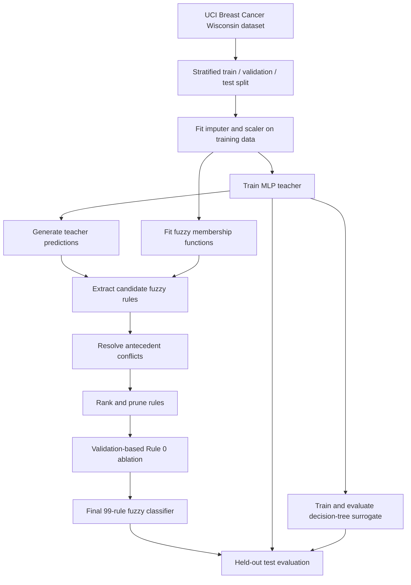

# Opening the Black Box: Extracting Fuzzy Rules from Trained Neural Networks

**An interpretable machine-learning experiment using fuzzy rule extraction and surrogate modelling.**

This project trains a Multi-Layer Perceptron (MLP) on the Breast Cancer Wisconsin (Diagnostic) dataset, then extracts a fuzzy rule-based classifier that approximates the MLP's predictions. It investigates the trade-off between predictive performance, fidelity to the teacher model, rule-base complexity, and interpretability.

> **Final result:** The selected fuzzy surrogate contains **99 rules** and achieves **88.37% test accuracy**, **86.99% test macro-F1**, and **87.21% fidelity** to the MLP on a held-out test set of 86 observations.

The repository includes the core implementation, saved model artifacts, experiment outputs, and automated tests. Some exploratory result files are preserved without their original generation scripts; their provenance is documented below.

---

## Table of contents

- [Project overview](#project-overview)
- [Problem statement](#problem-statement)
- [Objectives](#objectives)
- [Dataset](#dataset)
- [Methodology](#methodology)
  - [1. Data preparation](#1-data-preparation)
  - [2. MLP teacher model](#2-mlp-teacher-model)
  - [3. Fuzzy membership functions](#3-fuzzy-membership-functions)
  - [4. Rule extraction](#4-rule-extraction)
  - [5. Conflict resolution](#5-conflict-resolution)
  - [6. Fuzzy inference](#6-fuzzy-inference)
  - [7. Rule ranking and pruning](#7-rule-ranking-and-pruning)
  - [8. Rule ablation](#8-rule-ablation)
  - [9. Decision-tree surrogate](#9-decision-tree-surrogate)
- [System workflow](#system-workflow)
- [Experimental design](#experimental-design)
- [Evaluation metrics](#evaluation-metrics)
- [Results](#results)
  - [Final fuzzy model](#final-fuzzy-model)
  - [Comparison with other models](#comparison-with-other-models)
  - [Confusion matrices](#confusion-matrices)
  - [Rule ablation findings](#rule-ablation-findings)
- [Interpretability](#interpretability)
- [Repository structure](#repository-structure)
- [Getting started](#getting-started)
- [Running the project](#running-the-project)
- [Testing](#testing)
- [Saved artifacts and results](#saved-artifacts-and-results)
- [Reproducibility and experimental provenance](#reproducibility-and-experimental-provenance)
- [Technology stack](#technology-stack)
- [Limitations](#limitations)
- [Future work](#future-work)
- [Disclaimer](#disclaimer)

---

## Project overview

Neural networks can learn complex nonlinear relationships and achieve strong predictive performance, but their decisions are not naturally expressed as simple human-readable rules. This project explores whether the observable classification behaviour of a trained neural network can be approximated by a fuzzy rule-based surrogate.

The MLP acts as the **teacher**. Its predictions are used to assign consequents to fuzzy rules. The extracted rule base is then ranked, pruned, and evaluated as a separate classifier.

The work focuses on three complementary questions:

1. **Predictive performance:** How accurately does the fuzzy surrogate classify observations against the dataset's ground-truth labels?
2. **Model fidelity:** How often does the surrogate agree with the MLP teacher?
3. **Rule-base interpretability:** How much can the extracted representation be simplified while retaining useful predictive behaviour?

Accuracy and fidelity are not interchangeable. A surrogate may imitate the teacher on an observation even when the teacher itself predicts the wrong ground-truth class.

### At a glance

| Item | Description |
|---|---|
| Task | Binary classification |
| Dataset | Breast Cancer Wisconsin (Diagnostic) |
| Teacher model | Scikit-learn `MLPClassifier` |
| Surrogate | Mamdani-inspired fuzzy rule classifier |
| Initial extracted rules | 290 |
| Final fuzzy rules | **99** |
| Input features | 30 numerical features |
| Train / validation / test | 398 / 85 / 86 observations |
| Random seed | 42 |

---

## Problem statement

A trained neural network represents its decision function through learned parameters and nonlinear transformations across hidden layers. Its predictions can be inspected, but the reasoning is not directly available as a concise set of linguistic decision rules.

The project investigates the following question:

**Can the classification behaviour of a trained neural network be approximated using a fuzzy rule-based system while retaining useful predictive performance and providing a more inspectable representation?**

Given a trained teacher \(f_\theta\), the objective is to construct a fuzzy surrogate \(g_\phi\) such that:

\[
g_\phi(x) \approx f_\theta(x)
\]

Here, \(x\) is an input observation, \(f_\theta\) is the trained MLP, and \(g_\phi\) is the fuzzy classifier.

The goal is to approximate the teacher's observable predictions—not to reconstruct its internal weights, hidden representations, or exact computational process.

---

## Objectives

- Train an MLP teacher on a structured binary-classification dataset.
- Transform numerical features into fuzzy linguistic terms.
- Extract candidate IF–THEN rules using the teacher's predictions.
- Resolve conflicting rules with identical antecedents.
- Implement fuzzy antecedent evaluation and class-wise aggregation.
- Rank and prune rules to reduce the size of the rule base.
- Study the effect of removing an individual rule.
- Compare the fuzzy surrogate with the MLP teacher and a decision-tree surrogate.
- Evaluate predictive performance, teacher fidelity, coverage, fallback behaviour, and rule-base complexity.
- Preserve experiment configurations, outputs, model artifacts, and automated tests.

---

## Dataset

### Breast Cancer Wisconsin (Diagnostic)

The project uses the **Breast Cancer Wisconsin (Diagnostic)** dataset from the [UCI Machine Learning Repository](https://archive.ics.uci.edu/dataset/17/breast+cancer+wisconsin+diagnostic).

The dataset contains measurements computed from digitized images of fine needle aspirate samples of breast masses. Each observation has 30 numerical features describing cell-nucleus characteristics.

| Property | Value |
|---|---:|
| Observations | 569 |
| Input features | 30 |
| Classes | 2 |
| Feature type | Numerical |
| Task | Binary classification |

The target classes are encoded as:

- `0` — Benign
- `1` — Malignant

The 30 attributes cover mean, standard-error, and worst-case measurements of characteristics such as radius, texture, perimeter, area, smoothness, compactness, concavity, concave points, symmetry, and fractal dimension.

### Data split

A stratified split with random seed `42` preserves the class distribution across the partitions.

| Split | Proportion | Observations |
|---|---:|---:|
| Training | 70% | 398 |
| Validation | 15% | 85 |
| Test | 15% | 86 |
| **Total** | **100%** | **569** |

The partitions have separate roles:

- **Training:** Fit preprocessing, train the MLP, and define membership functions.
- **Validation:** Compare rule-selection configurations and make model-selection decisions.
- **Test:** Evaluate the selected model once on held-out observations.

The test set is not used to select the final rule configuration.

---

## Methodology

### 1. Data preparation

The preprocessing pipeline consists of:

1. **Median imputation** for missing numerical values, where present.
2. **Standardisation** using scikit-learn's `StandardScaler`.

For a feature value \(x\), standardisation is:

\[
z = \frac{x-\mu}{\sigma}
\]

where \(\mu\) and \(\sigma\) are estimated from the training data.

The imputer and scaler are fitted **only on the training split**. The fitted transformations are then applied unchanged to the validation and test splits. This prevents information from those partitions from leaking into preprocessing.

The fitted preprocessing pipeline is saved as `artifacts/preprocessor.joblib`.

### 2. MLP teacher model

The teacher is a scikit-learn `MLPClassifier` with two hidden layers.

**Architecture**

\[
30 \rightarrow 16 \rightarrow 8 \rightarrow 1
\]

The final output dimension is one because scikit-learn uses a single output unit for this binary classification configuration.

| Parameter | Value |
|---|---|
| Estimator | `MLPClassifier` |
| Hidden-layer sizes | `(16, 8)` |
| Activation | `relu` |
| Solver | `adam` |
| L2 regularisation (`alpha`) | `0.001` |
| Initial learning rate | `0.001` |
| Maximum iterations | `500` |
| Random state | `42` |
| Early stopping | `False` |

The trained MLP generates class predictions used by the rule-extraction process. Its fitted model is stored in `artifacts/mlp_model.joblib`.

### 3. Fuzzy membership functions

Each of the 30 standardised numerical features is represented by three fuzzy terms:

| Term | Interpretation |
|---|---|
| `Low` | Lower part of the feature range |
| `Medium` | Intermediate part of the feature range |
| `High` | Upper part of the feature range |

The implementation uses triangular membership functions. Their parameters are derived from the **training-set minimum, median, and maximum** for each feature:

- `Low`: \((\min,\min,\text{median})\)
- `Medium`: \((\min,\text{median},\max)\)
- `High`: \((\text{median},\max,\max)\)

A triangular membership function is defined by:

\[
\mu(x;a,b,c)=
\max\left(
\min\left(
\frac{x-a}{b-a},
\frac{c-x}{c-b}
\right),0
\right)
\]

where \(a\), \(b\), and \(c\) define the triangle's left endpoint, peak, and right endpoint. The membership degree lies between 0 and 1.

The fitted definitions are saved in `artifacts/membership_functions.joblib`.

### 4. Rule extraction

For each training observation, the extractor:

1. Evaluates the observation against the three membership terms for every feature.
2. Selects the term with the highest membership degree for each feature.
3. Uses the MLP's predicted class as the rule consequent.
4. Calculates a rule weight from the selected membership degrees.
5. Groups observations that produce identical antecedents.

For feature \(j\), the selected term is:

\[
A_j = \arg\max_{t \in \{Low,Medium,High\}} \mu_{j,t}(x_j)
\]

The rule weight is the product of the selected membership degrees across the 30 features:

\[
w_r = \prod_{j=1}^{30}\mu_{j,A_j}(x_j)
\]

Ties between membership terms are resolved deterministically by selecting the alphabetically smallest term. Each observation initially contributes support of one; support is accumulated when identical rules are grouped.

A rule has the general form:

```text
IF feature_1 is Medium
AND feature_2 is Low
AND feature_3 is High
...
AND feature_30 is Medium
THEN class is Malignant
```

The extraction process produces **290 initial rules** after identical antecedents are grouped and conflicts are resolved.

### 5. Conflict resolution

Identical antecedents can be associated with different teacher-predicted classes. The extractor groups rules with the same antecedent and resolves the conflict by retaining the consequent with the **highest aggregate rule weight**.

The support value records the number of observations contributing to the retained rule. Rule weight and support are preserved as metadata and used during ranking and pruning.

### 6. Fuzzy inference

The implementation is a **Mamdani-inspired fuzzy rule classifier**, not a complete conventional Mamdani fuzzy inference system. It uses:

- Minimum t-norm for antecedent conjunction.
- Maximum aggregation within each output class.
- Winner-take-all classification across class activation scores.

It does **not** implement fuzzy output-set aggregation followed by centroid defuzzification. The consequents are categorical class labels.

#### A. Fuzzification

Each input feature is evaluated against its `Low`, `Medium`, and `High` membership functions.

#### B. Antecedent evaluation — minimum t-norm

For a rule with \(n\) antecedents, its firing strength is:

\[
\alpha_r = \min\left(\mu_1(x_1),\mu_2(x_2),\ldots,\mu_n(x_n)\right)
\]

The minimum operator makes the weakest antecedent membership degree determine the rule's firing strength.

#### C. Class-wise maximum aggregation

For each class \(c\), the inference engine retains the maximum firing strength among rules with that consequent:

\[
S_c = \max_{r:C_r=c}\alpha_r
\]

#### D. Winner-take-all decision

The predicted class is the class with the highest aggregated activation:

\[
\hat{y} = \arg\max_c S_c
\]

Ties are resolved using a deterministic class-order rule. If no rule fires, the configured fallback class is used and the event is recorded for coverage and fallback evaluation.

**Important implementation detail:** Rule weights and support do not scale firing strengths during inference. They are extraction metadata used for analysis, ranking, and pruning.

### 7. Rule ranking and pruning

The initial rule base contains 290 rules. Rules are ranked using extraction metadata, including weight and support. The following configurations are compared on the validation set:

- All 290 rules
- Top 10
- Top 25
- Top 50
- Top 100

The comparison considers accuracy, macro-F1, fidelity, coverage, fallback rate, and rule-base size. A larger rule base does not necessarily improve every metric, so selection is based on validation evidence rather than rule count alone.

### 8. Rule ablation

After selecting the top-100 configuration, an ablation experiment removes one rule at a time to study its effect. The original rule at index `0` is a broad all-`Medium` benign rule.

Removing this rule improves validation accuracy and macro-F1 while leaving coverage unchanged:

| Validation metric | Top 100 rules | After removing Rule 0 |
|---|---:|---:|
| Accuracy | 80.00% | 87.06% |
| Macro-F1 | 76.70% | 85.94% |
| Malignant recall | 56.25% | 78.12% |
| Coverage | 98.82% | 98.82% |

The selected final rule base therefore contains **99 rules**: the selected top 100 with original Rule 0 removed. This decision is based on validation results; the test set is reserved for the final evaluation.

### 9. Decision-tree surrogate

A decision-tree surrogate is also trained to imitate the MLP teacher. It provides a second interpretable baseline against which to compare the fuzzy rule classifier.

The tree is selected using validation fidelity from combinations of:

- `max_depth`: 2, 3, 4, 5, 6, 8, 10
- `min_samples_leaf`: 2, 5, 10, 15

The selected configuration has `max_depth=3` and `min_samples_leaf=5`. It has six leaves and uses four features. It is trained to reproduce teacher predictions, so its fidelity measures agreement with the MLP rather than accuracy against ground-truth labels.

---

## System workflow

The main experimental flow is:



---

## Experimental design

The experiments examine the effects of rule-base size, rule selection, antecedent length, and inference operators.

| Experiment | Question |
|---|---|
| Rule-count pruning | How does the number of retained rules affect performance and fidelity? |
| Antecedent reduction | Can rules use fewer feature conditions while retaining useful behaviour? |
| Class-aware pruning | Does class-sensitive rule selection help minority-class performance? |
| Threshold experiments | How do alternative selection thresholds affect the results? |
| T-norm comparison | How do minimum and product conjunction differ? |
| Rule ablation | What changes when an individual rule is removed? |
| False-negative analysis | Which observations are missed, and how do rules behave for them? |
| Firing diagnostics | How do rule activations contribute to inference behaviour? |
| Decision-tree comparison | How does a tree surrogate compare with the fuzzy surrogate? |

The minimum t-norm is retained in the final fuzzy model. In the tested configurations, removing Rule 0 had a larger effect on validation performance than switching between the minimum and product t-norms. This is an observation about these experiments, not a general claim that the choice of conjunction operator is unimportant.

---

## Evaluation metrics

The project uses multiple metrics because no single measure captures both predictive performance and imitation quality.

| Metric | Meaning |
|---|---|
| Accuracy | Fraction of observations correctly classified against ground truth |
| Precision | Fraction of predicted positive observations that are truly positive |
| Recall | Fraction of actual positive observations correctly identified |
| F1-score | Harmonic mean of precision and recall |
| Macro-F1 | Unweighted mean of the per-class F1-scores |
| Fidelity | Fraction of observations on which the surrogate agrees with the MLP teacher |
| Coverage | Fraction of observations for which at least one rule fires |
| Fallback rate | Fraction of observations classified using the fallback mechanism |
| Rule count | Number of retained rules |
| Rule length | Number of antecedent conditions per rule |

For binary classification:

\[
Accuracy = \frac{TP+TN}{TP+TN+FP+FN}
\]

\[
Precision = \frac{TP}{TP+FP}
\qquad
Recall = \frac{TP}{TP+FN}
\]

\[
F1 = 2\cdot\frac{Precision\cdot Recall}{Precision+Recall}
\]

Fidelity is calculated against teacher predictions:

\[
Fidelity =
\frac{1}{N}\sum_{i=1}^{N}
\mathbb{1}\left[g_\phi(x_i)=f_\theta(x_i)\right]
\]

Coverage is:

\[
Coverage =
\frac{\text{Observations covered by at least one rule}}
{\text{Total observations}}
\]

A high fidelity score means that the surrogate imitates the teacher more closely. It does not necessarily mean that the surrogate is more accurate against the ground-truth labels.

---

## Results

All final comparison metrics below are measured on the **held-out test set of 86 observations**.

### Final fuzzy model

<details>
<summary><strong>Final 99-rule fuzzy surrogate — test metrics</strong></summary>

| Metric | Result |
|---|---:|
| Accuracy | 88.37% |
| Macro-F1 | 86.99% |
| Fidelity to MLP | 87.21% |
| Malignant precision | 92.31% |
| Malignant recall | 75.00% |
| Coverage | 100.00% |
| Fallback rate | 0.00% |
| Number of rules | 99 |
| Mean rule length | 30 |

</details>

### Comparison with other models

| Test metric | MLP teacher | Fuzzy surrogate | Decision-tree surrogate |
|---|---:|---:|---:|
| Accuracy | **98.84%** | 88.37% | 93.02% |
| Macro-F1 | **98.75%** | 86.99% | 92.20% |
| Fidelity to MLP | 100.00%* | 87.21% | **94.19%** |
| Coverage | N/A | 100.00% | N/A |

- The MLP teacher has the highest test accuracy and macro-F1.
- The decision-tree surrogate outperforms the fuzzy surrogate on test accuracy, macro-F1, and fidelity.
- The fuzzy model provides a different form of representation: a collection of linguistic IF–THEN rules whose firing behaviour can be inspected.
- The MLP's `100%` fidelity is a self-comparison against its own predictions, not an independent surrogate result.

### Confusion matrices

Rows are actual classes and columns are predicted classes. Class `0` is benign; class `1` is malignant.

**Fuzzy surrogate**

\[
\begin{bmatrix}
52 & 2\\
8 & 24
\end{bmatrix}
\]

| Actual / Predicted | Benign | Malignant |
|---|---:|---:|
| Benign | 52 | 2 |
| Malignant | 8 | 24 |

**MLP teacher**

\[
\begin{bmatrix}
54 & 0\\
1 & 31
\end{bmatrix}
\]

**Decision-tree surrogate**

\[
\begin{bmatrix}
54 & 0\\
6 & 26
\end{bmatrix}
\]

The fuzzy surrogate correctly identifies 24 of the 32 malignant test observations. It produces eight false negatives and two false positives. This is an important limitation of the final model.

### Rule ablation findings

On the validation set, removing Rule 0 changes the number of correct predictions from 68 to 74. Seven previously incorrect predictions become correct, while one previously correct prediction becomes incorrect. Coverage remains at 98.82%.

The final 99-rule model subsequently achieves 100% coverage on the held-out test set. Validation and test coverage are separate measurements and should not be conflated.

### Result files

Detailed outputs are stored in `results/`. The principal files include:

| File | Contents |
|---|---|
| `metrics.csv` | Consolidated experiment metrics |
| `metrics_summary.csv` | Metrics summary |
| `mlp_metrics.json` | MLP teacher metrics |
| `pruning_validation.csv` | Rule-count pruning results |
| `antecedent_reduction_validation.csv` | Antecedent-reduction results |
| `class_aware_pruning_validation.csv` | Class-aware pruning results |
| `threshold_validation.csv` | Threshold experiment results |
| `activation_diagnostic.csv` | Activation diagnostics |
| `feature_importance.csv` | Preserved feature-importance results |
| `false_negative_rule_details.csv` | Rule-level false-negative analysis |
| `false_negative_rule_summary.csv` | False-negative analysis summary |
| `remaining_false_negatives.csv` | Remaining false-negative observations |
| `rule_0_ablation_changes.csv` | Prediction changes from Rule 0 ablation |
| `final_candidate_test_predictions.csv` | Final fuzzy-model test predictions |
| `decision_tree_validation.csv` | Decision-tree validation results |
| `decision_tree_test_predictions.csv` | Decision-tree test predictions |
| `model_comparison_test.csv` | Held-out comparison of the three models |
| `reproducibility_manifest.json` | Experiment and file-hash metadata |

---

## Interpretability

The fuzzy surrogate expresses its predictions through linguistic conditions rather than the MLP's learned numerical weights.

A rule has the general form:

```text
IF feature_1 is High
AND feature_2 is Medium
AND feature_3 is Low
...
THEN class is Malignant
```

The implementation makes it possible to inspect:

- The antecedent conditions and predicted class of each rule.
- Rule weight and support metadata.
- The firing strength of a rule for a particular observation.
- Which rules contribute to each class activation.
- The effects of pruning and ablation.
- The inference audit trace, including fired rules, antecedent strengths, firing strengths, and consequents.

**Interpretability caveat:** The final rule base contains 99 rules, and each rule contains 30 antecedent conditions. The rules are inspectable, but they are not necessarily short or easy to interpret individually. They approximate the teacher's behaviour; they are not exact explanations of the MLP's internal computations.

---

## Repository structure

The main repository layout is:

```text
fuzzy-rule-extraction/
├── artifacts/
│   ├── final_model_metadata.json
│   ├── final_rules_top99.joblib
│   ├── membership_functions.joblib
│   ├── mlp_model.joblib
│   ├── preprocessor.joblib
│   ├── selection_metadata.json
│   └── feature_metadata.json
├── data/
│   ├── raw/
│   └── processed/
├── results/
│   ├── metrics.csv
│   ├── metrics_summary.csv
│   ├── mlp_metrics.json
│   ├── mlp_train_predictions.csv
│   ├── mlp_validation_predictions.csv
│   ├── mlp_test_predictions.csv
│   ├── pruning_validation.csv
│   ├── antecedent_reduction_validation.csv
│   ├── class_aware_pruning_validation.csv
│   ├── threshold_validation.csv
│   ├── feature_importance.csv
│   ├── activation_diagnostic.csv
│   ├── false_negative_rule_details.csv
│   ├── false_negative_rule_summary.csv
│   ├── remaining_false_negatives.csv
│   ├── rule_0_ablation_changes.csv
│   ├── final_candidate_test_predictions.csv
│   ├── decision_tree_validation.csv
│   ├── decision_tree_test_predictions.csv
│   ├── model_comparison_test.csv
│   └── reproducibility_manifest.json
├── src/
│   ├── data_pipeline.py
│   ├── train_mlp.py
│   ├── predict.py
│   ├── membership.py
│   ├── rule_types.py
│   ├── extract_rules.py
│   ├── fuzzy_inference.py
│   ├── prune_rules.py
│   ├── evaluate.py
│   ├── evaluate_final_candidate.py
│   ├── train_decision_tree.py
│   ├── run_experiments.py
│   ├── compare_tnorms.py
│   ├── analyze_results.py
│   ├── report_tables.py
│   ├── visualize_results.py
│   ├── reproducibility.py
│   ├── update_metadata.py
│   ├── analyze_ablation_changes.py
│   ├── analyze_false_negative_rules.py
│   ├── analyze_firing_bottlenecks.py
│   ├── analyze_remaining_false_negatives.py
│   ├── compare_competing_antecedents.py
│   ├── inspect_competing_rules.py
│   └── test_rule_ablation.py
├── tests/
│   ├── test_analyze_results.py
│   ├── test_evaluate.py
│   ├── test_extract_rules.py
│   ├── test_inference.py
│   ├── test_membership.py
│   ├── test_prune_rules.py
│   ├── test_report_tables.py
│   ├── test_reproducibility.py
│   ├── test_rule_types.py
│   ├── test_run_experiments.py
│   └── test_visualize_results.py
├── report/
├── presentation/
├── config.yaml
├── requirements.txt
├── .gitignore
└── README.md
```

Some generated data and result files may be omitted from a fresh clone or excluded by `.gitignore`; consult the repository for the artifacts actually tracked in version control.

### Key saved artifacts

| Artifact | Purpose |
|---|---|
| `mlp_model.joblib` | Trained MLP teacher |
| `preprocessor.joblib` | Fitted imputation and scaling pipeline |
| `membership_functions.joblib` | Fitted fuzzy membership functions |
| `final_rules_top99.joblib` | Final 99-rule fuzzy model |
| `final_model_metadata.json` | Final model configuration and evaluation metadata |
| `selection_metadata.json` | Validation-based selection details |
| `feature_metadata.json` | Dataset, feature, and split metadata |

---

## Getting started

### Prerequisites

- Python 3.10 or later
- Git
- `pip`

The project was developed and tested with Python 3.12.3.

### 1. Clone the repository

```bash
git clone https://github.com/manasvi2909/fuzzy-rule-extraction.git
cd fuzzy-rule-extraction
```

### 2. Create a virtual environment

**macOS / Linux**

```bash
python3 -m venv .venv
source .venv/bin/activate
```

**Windows (PowerShell)**

```powershell
py -m venv .venv
.venv\Scripts\Activate.ps1
```

### 3. Install dependencies

```bash
python -m pip install --upgrade pip
python -m pip install -r requirements.txt
```

---

## Running the project

Run commands from the repository root.

### Core data and teacher-model stages

The following command-line stages prepare the dataset and generate the teacher model and its predictions:

```bash
# 1. Download/load the dataset, create stratified splits, and preprocess
python -m src.data_pipeline

# 2. Train the MLP teacher
python -m src.train_mlp

# 3. Generate teacher predictions for the data splits
python -m src.predict
```

These stages can regenerate data, model artifacts, and prediction files. They may overwrite existing outputs. The initial dataset preparation may require an internet connection if the raw dataset is not already available locally.

### Fuzzy extraction and evaluation modules

The fuzzy pipeline is exposed through reusable Python functions and modules. The repository does not currently provide one command that orchestrates every stage from raw data through final evaluation.

| Module | Function / entry point | Purpose |
|---|---|---|
| `src/membership.py` | `fit_membership_functions()` | Fit membership functions using training data |
| `src/membership.py` | `fuzzify_dataframe()` | Convert observations into membership degrees |
| `src/extract_rules.py` | `extract_rules()` | Extract and resolve fuzzy rules using teacher predictions |
| `src/prune_rules.py` | `prune_rules()` | Rank and select the top-N rules |
| `src/fuzzy_inference.py` | `predict_dataset()` | Predict using a fuzzy rule base |
| `src/run_experiments.py` | `run_rule_experiments()` | Evaluate full and pruned rule bases |
| `src/evaluate_final_candidate.py` | Script | Evaluate the final 99-rule candidate using saved intermediate artifacts |

The final evaluation script expects the processed test data, MLP test predictions, membership functions, and selected top-100 rules to be available. It removes original Rule 0 before evaluating the final candidate.

For the exact function arguments and configuration used in the experiments, refer to the corresponding source modules and `config.yaml`.

---

## Testing

Run the automated test suite from the repository root:

```bash
pytest -v
```

The project test run recorded **89 passing tests**.

The tests cover:

- Membership-function behaviour and parameter validation.
- Fuzzification of individual observations and datasets.
- Candidate rule generation and conflict resolution.
- Rule data structures and validation.
- Minimum t-norm inference and maximum aggregation.
- Class prediction, tie handling, fallback behaviour, and coverage.
- Rule ranking and pruning.
- Evaluation metrics.
- Experiment configuration validation.
- Reproducibility metadata and file hashing.
- Result-table generation and visualisation utilities.

---

## Saved artifacts and results

The repository separates fitted artifacts from experiment outputs:

- `artifacts/` contains serialized models, membership functions, final rules, and metadata.
- `results/` contains evaluation metrics, prediction exports, diagnostics, and experiment result tables.
- `report/` and `presentation/` contain the project documentation and presentation materials, where tracked.

The `.joblib` files are Python object serializations. Load only artifacts from sources you trust.

---

## Reproducibility and experimental provenance

The core pipeline uses random seed `42` for the dataset split and MLP configuration. The repository preserves:

- Dataset split and feature metadata.
- Preprocessing configuration and fitted artifacts.
- MLP architecture and hyperparameters.
- Fuzzy membership-function definitions.
- Rule-selection metadata.
- Inference configuration.
- Evaluation metrics and prediction exports.
- Selected input-file hashes, package versions, and experiment parameters.

The manifest is stored at `results/reproducibility_manifest.json`.

**Reproducibility scope:** The manifest supports traceability and change detection; it does not guarantee that every exploratory result can be regenerated. The core training, extraction, pruning, inference, and final evaluation stages are documented in the source modules, but they are not currently connected by a single end-to-end command.

The result files for antecedent reduction, class-aware pruning, threshold experiments, and feature importance are preserved in `results/`. Their original generation code is not available in the current repository history. Treat these files as recorded exploratory results rather than fully reproducible experiments. The corresponding results should not be interpreted as independently regenerated by the documented core pipeline.

The saved final artifacts can be inspected without retraining the MLP. Exact regeneration of the full experiment requires the appropriate intermediate artifacts and execution of the documented stages in sequence.

---

## Technology stack

| Technology | Role |
|---|---|
| Python | Core implementation |
| NumPy | Numerical computation |
| Pandas | Dataset handling and result analysis |
| scikit-learn | Preprocessing, MLP, decision tree, and evaluation |
| Joblib | Model and artifact serialization |
| Matplotlib | Result visualisation |
| PyYAML | Configuration loading |
| Pytest | Automated testing |
| Git and GitHub | Version control and collaboration |

---

## Limitations

1. **Approximation, not equivalence.** The fuzzy surrogate imitates the teacher's predictions but does not reproduce the MLP's internal representations or guarantee identical outputs.
2. **Predictive-performance trade-off.** The fuzzy surrogate achieves 88.37% test accuracy, compared with 98.84% for the MLP teacher.
3. **Long rules.** The final model has 99 rules, each with 30 antecedent conditions. Reducing the rule count does not automatically make each rule concise.
4. **Limited test sample.** The held-out test set contains 86 observations, so individual predictions have a noticeable effect on reported metrics.
5. **Single random seed.** The reported results use seed 42. Performance and rule selection may vary with other data splits and training initialisations.
6. **Exploratory-result provenance.** Some exploratory result CSVs are retained without the scripts that originally generated them.
7. **No clinical validation.** The dataset is used as a machine-learning benchmark. The resulting models have not been clinically validated.

---

## Future work

Potential extensions include:

- **Antecedent simplification:** Reduce the number of conditions per rule while retaining useful predictive behaviour.
- **Alternative extraction methods:** Explore rule-generation approaches beyond strongest-membership discretisation.
- **Rule merging:** Identify similar rules and combine them where this does not damage performance.
- **Joint pruning objectives:** Optimise predictive performance, teacher fidelity, coverage, and complexity together.
- **Alternative membership functions:** Evaluate Gaussian, trapezoidal, and adaptive membership functions.
- **Multi-seed evaluation:** Measure stability across multiple random splits and training initialisations.
- **Additional datasets:** Test the extraction framework on other structured classification problems.
- **Interpretability evaluation:** Measure rule redundancy, comprehensibility, and feature-level explanation quality.
- **Inference improvements:** Investigate alternative aggregation and decision mechanisms.

---

## Disclaimer

This repository is an academic investigation into interpretable machine learning and fuzzy rule extraction. The Breast Cancer Wisconsin (Diagnostic) dataset is used for experimental classification only.

**Neither the MLP nor the extracted fuzzy surrogate is a clinically validated diagnostic system. The models must not be used to diagnose, screen, or guide medical treatment.**

---

## Project summary

This project demonstrates an experimental pipeline for approximating a neural network's classification behaviour using fuzzy IF–THEN rules. The final fuzzy surrogate contains **99 rules** and achieves **88.37% test accuracy**, **86.99% test macro-F1**, **87.21% fidelity**, and **100% test coverage**.

The MLP remains the strongest predictor in the comparison, while the decision-tree surrogate outperforms the fuzzy surrogate on the reported test metrics. The main contribution of the fuzzy approach is its rule-based representation and the ability to inspect rule activations—not a claim that it is the most accurate model.

**The central question is not simply whether a smaller model can classify the data, but how the behaviour of a trained neural network can be translated into an inspectable collection of fuzzy rules.**
